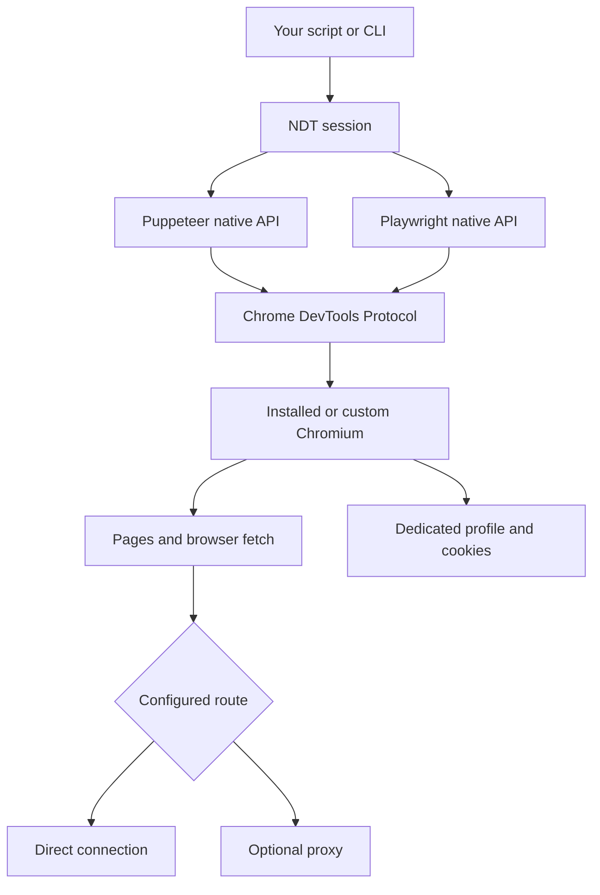

<div align="center">

# ◈ NDT Browser

**Real browsers. Native automation. One small toolkit.**

Puppeteer · Playwright · Browser-session APIs · Scraping

[](https://github.com/nguyenduytan/ndt-browser/actions/workflows/ci.yml)
[](https://github.com/nguyenduytan/ndt-browser/releases)
[](https://nodejs.org/)
[](LICENSE)

**English** · [Tiếng Việt](README.vi.md)

[Quick start](#-quick-start) · [Automation](#automation) · [API requests](#api-requests) · [Challenges](#challenge-handling) · [Configuration](#configuration)

</div>

---

NDT launches an installed Chrome/Chromium as a separate process, then connects
Puppeteer or Playwright over CDP. You get real native `browser`, `context` and `page`
objects plus small helpers for profiles, browser fetch, extraction and challenge waits.

**v0.1 is an automation toolkit with best-effort detection-signal controls.** It is
not a patched Chromium distribution, a CAPTCHA-solving service, or a guarantee of
Cloudflare clearance. Read [fingerprint controls](#fingerprint-and-runtime-controls)
before choosing a runtime.

## What is included

| Capability | Puppeteer | Playwright |
|---|:---:|:---:|
| Local Chromium launch / remote CDP | ✓ | ✓ |
| Native click, keyboard, mouse, frames, evaluate | ✓ | ✓ |
| Native network hooks, screenshots, downloads | ✓ | ✓ |
| Persistent profiles and cookie reuse | ✓ | ✓ |
| Browser-session GET/POST and JSON | ✓ | ✓ |
| CSS/text/attribute extraction | ✓ | ✓ |
| Viewport, locale, timezone, UA and UA metadata | ✓ | ✓ |
| Authenticated HTTP proxy | ✓ | ✓ |
| Optional image/font/media/stylesheet blocking | ✓ | ✓ |
| Challenge wait and bounded opt-in widget click | ✓ | ✓ |

The underlying native APIs remain driver-specific. Playwright connects to Chromium
through CDP, not the Playwright protocol; CDP has lower fidelity than Playwright's
own launch/connect protocol. Firefox and WebKit are outside this release.

## Architecture



There is no database, cloud account, CAPTCHA provider or implicit browser download.
Both driver packages are included; Chromium itself is installed separately.

## 🚀 Quick start

Requirements: Node.js **22.12+** and Chrome, Chromium or Edge. On Linux, headed mode
also needs a display; use `headless: true` for a server without one.

Install the GitHub release archive (npm registry publication is not required):

```bash
npm install https://github.com/nguyenduytan/ndt-browser/releases/download/v0.1.0/nguyenduytan-ndt-browser-0.1.0.tgz
```

Create `scrape.mjs`:

```js
import { connect } from '@nguyenduytan/ndt-browser';

const session = await connect({ driver: 'puppeteer', headless: true });
try {
  await session.page.goto('https://example.com', { waitUntil: 'domcontentloaded' });
  console.log(await session.extract({ title: 'h1' }));
} finally {
  await session.close();
}
```

```bash
node scrape.mjs
```

Chrome/Edge is discovered in common install locations. To choose an exact runtime:

```js
const session = await connect({
  driver: 'playwright',
  executablePath: '/path/to/chromium', // On Windows: C:/path/to/chrome.exe
  headless: true,
});
```

Alternatively set `NDT_BROWSER_PATH`. An invalid explicit path fails; it never
silently selects a different browser. `headless` defaults to **false**.

## Automation

### Puppeteer

```js
const session = await connect({ driver: 'puppeteer' });
try {
  const { page } = session;
  await page.goto('https://your-app.example/form');
  await page.type('#name', 'Tony');
  await page.click('button[type="submit"]');
  await page.waitForSelector('.success');
  await page.screenshot({ path: 'result.png', fullPage: true });
} finally { await session.close(); }
```

### Playwright

```js
const session = await connect({ driver: 'playwright' });
try {
  const { page } = session;
  await page.goto('https://your-app.example/form');
  await page.getByLabel('Name').fill('Tony');
  await page.getByRole('button', { name: 'Save' }).click();
  await page.locator('.success').waitFor();
  console.log(await page.locator('.success').innerText());
} finally { await session.close(); }
```

Use native methods for uploads, downloads, navigation waits, screenshots, frames,
keyboard/mouse input and request interception. NDT does not replace those APIs.
For a click that triggers navigation, register the wait before clicking, following
your driver's API. Clicks and POST requests are **never automatically retried**.

### More pages and native hooks

```js
const page = await session.newPage(); // NDT settings are applied before return.
await page.goto('https://example.com');
console.log(await session.extract({ title: 'h1' }, page));
```

If you create a page directly with `session.context.newPage()`, call
`await session.configurePage(page)` **before navigation**. Settings are per page;
popups, workers and pages created through native APIs are not automatically patched.
Do not combine native interception with NDT resource blocking/proxy authentication
without testing their interaction: both may use CDP Fetch interception.

## API requests

`session.request()` executes `fetch` **inside the selected page**. It uses browser
cookies, browser networking and the browser's proxy. It never falls back to Node's
direct HTTP client. Navigate to the API's origin first.

```js
await session.page.goto('https://your-app.example');

const response = await session.request('https://your-app.example/api/items', {
  method: 'POST',
  json: { name: 'NDT', enabled: true },
  headers: { 'x-csrf-token': csrfToken }, // Obtain from your application.
  timeout: 15_000,
  maxBytes: 2 * 1024 * 1024,
});

if (!response.ok) throw new Error(`API returned HTTP ${response.status}`);
console.log(response.json());
```

| Option | Default | Meaning |
|---|---|---|
| `method` | `GET` | Fetch HTTP method |
| `headers` | none | Request headers allowed by browser fetch |
| `json` | none | JSON body; adds content-type when absent |
| `body` | none | String body; mutually exclusive with `json` |
| `credentials` | `same-origin` | Browser fetch credentials policy |
| `timeout` | Session timeout | Aborts the fetch/read after this many milliseconds |
| `maxBytes` | 10 MiB | Maximum decoded response bytes read |

Result: `{ url, status, ok, headers, body, json() }`. `body` is UTF-8 text;
`json()` parses it and throws for invalid JSON. HTTP errors return a response;
transport errors, timeout and byte-limit failures reject. GET/HEAD cannot have a body.

For forms, pass `body: new URLSearchParams(fields).toString()` with the appropriate
content type. For advanced binary streaming or multipart requests, use native APIs.

**CORS, CSRF and forbidden-header rules still apply.** Cross-origin APIs require the
server's CORS support. Browser fetch cannot reliably read an interstitial as API data;
navigate and resolve the page flow first. Do not automatically repeat a POST after a timeout:
the server may already have applied it. Playwright's native `context.request` is a
different transport and does not inherit NDT's browser-route guarantee.

## Extraction

```js
const data = await session.extract({
  title: 'h1',
  price: { selector: '[data-price]', attribute: 'data-price', required: true },
  links: { selector: 'a', attribute: 'href', multiple: true },
});
```

- Text is `textContent.trim()`, not a visibility-aware text algorithm.
- Missing single field/attribute: `null`. Missing multiple field: `[]`.
- `required: true` rejects missing elements or attributes. Empty text remains `''`.
- Attribute values stay raw; resolve relative URLs with `new URL(value, page.url())`.
- Invalid CSS fails explicitly. Extraction operates on the main document's DOM.
  Use native frame/locator APIs for iframes and shadow DOM.

## Challenge handling

```js
import { connect, ChallengeTimeoutError } from '@nguyenduytan/ndt-browser';

const session = await connect({ driver: 'playwright', userDataDir: './profiles/site' });
try {
  await session.page.goto('https://your-app.example');
  const result = await session.waitForChallenge({
    readySelector: '#app', // Prefer a selector that proves the intended page is ready.
    timeout: 45_000,
    clickTurnstile: true, // Explicit opt-in; at most three recognized-widget clicks.
    maxClicks: 3,
  });
  console.log(result); // { status: 'ready', detected, clicks, elapsedMs }
} catch (error) {
  if (error instanceof ChallengeTimeoutError) console.error('Manual action or a different runtime is needed.');
  else throw error;
} finally { await session.close(); }
```

NDT observes known interstitial markers, main-document `cf-mitigated: challenge`
responses, Turnstile widgets and the standard response field. It waits for the
challenge to disappear or a widget response to appear, then requires a stable ready
state. It tolerates navigation during challenge redirects. An `AbortSignal` can cancel
the wait. Default polling is 250 ms, stable readiness is 500 ms and timeout is 30 s.

Optional clicking uses the native mouse on a visible recognized widget with a bounded
attempt count and cooldown. **It is a heuristic, not a solver.** Closed shadow DOM,
custom layouts, custom response-field names and provider changes may need native
automation or manual interaction. A response token is not proof that the website
accepted it. `readySelector` should identify the content your task actually needs.

Local fixtures verify waiting, clicks, cancellation and failure limits. They do not
prove live Cloudflare clearance. NDT does not ship CAPTCHA providers, token forgery,
or a claim of universal bypass. Use browser automation where you have permission.

## Fingerprint and runtime controls

```js
const session = await connect({
  driver: 'puppeteer',
  headless: false,
  userDataDir: './profiles/my-site',
  reduceAutomationSignals: true,
  fingerprint: {
    locale: 'en-US',
    timezone: 'America/New_York',
    viewport: { width: 1365, height: 768, deviceScaleFactor: 1 },
    // userAgent and userAgentMetadata are available when you need an explicit pair.
  },
  args: [], // Additional Chromium arguments; ownership/routing flags are reserved.
});
```

NDT starts Chromium without a driver's launch-flag bundle. By default it sets
`--disable-blink-features=AutomationControlled`; disable this with
`reduceAutomationSignals: false`. It does not disable Chromium's sandbox by default.
Locale/timezone/viewport and optional user agent metadata use native CDP settings.

This does **not** patch canvas, WebGL, audio, fonts, TLS, browser internals or all
automation signals. Workers/popups may expose different settings. UA overrides can
be inconsistent with real hardware/client hints; avoid invented random fingerprints.

Use `executablePath` and `args` for a compatible custom Chromium binary, or connect to
a runtime launched externally. NDT does not download, license, update or certify
CloakBrowser/other third-party binaries. Their terms and compatibility apply separately.

## Profiles, remote browsers and cleanup

```js
// Local persistent profile: cookies/storage/cache survive close.
const local = await connect({ userDataDir: './profiles/catalog', headless: true });
await local.close();

// Remote: creates a fresh context and preserves the owner's existing tabs.
const remote = await connect({ driver: 'playwright', endpoint: process.env.CDP_URL });
try { await remote.page.goto('https://example.com'); }
finally { await remote.close(); }
```

Temporary profiles are removed after the owned browser exits. Persistent profiles
remain on disk. Use dedicated directories; never point NDT at your everyday browser
profile. One active NDT session owns a profile at a time. Cookies and cache are sensitive
local files; apply OS access controls and exclude them from Git/backups as appropriate.

`close()` is idempotent. Remote close only closes NDT's context and disconnects.
Local close shuts down its browser and cleans up its temporary profile. Prefer
`try/finally`; abrupt process termination can leave a browser and `.ndt-lock` behind.
Only remove a stale lock/`DevToolsActivePort` after confirming that no browser owns
that dedicated profile. NDT intentionally refuses to guess after a crash.

Remote mode rejects local profile, proxy, executable, headless and launch-argument
options. Configure those on the remote runtime. `session.endpoint` is a privileged
CDP address: keep it private. Native `browser.close()` is outside NDT's ownership
guard; use **`session.close()`** for borrowed browsers.

## Proxy and bandwidth

```js
const session = await connect({
  headless: true,
  userDataDir: './profiles/catalog',
  proxy: { server: process.env.PROXY_SERVER, username: process.env.PROXY_USER, password: process.env.PROXY_PASSWORD },
  blockResources: ['image', 'font', 'media'], // Off by default.
});
// ... run automation ...
console.log(session.stats); // requests, blocked, transferredBytes
```

HTTP(S) endpoints and unauthenticated SOCKS5 can be configured. Local integration
tests cover authenticated **HTTP** routing for both drivers. SOCKS5 username/password
is rejected. Credentials are supplied only to proxy authentication challenges, not
origin authentication challenges. Chromium's normal proxy bypass rules still apply
(including local addresses); this is not a network leak-prevention boundary.

Reuse sessions and persistent cache, fetch the API you need, and block optional heavy
resources when the site permits it. Avoid blocking challenge scripts or application
assets needed for correctness. `transferredBytes` is CDP encoded transfer data for
configured pages, not your provider's bill or all browser background traffic.

## Configuration

| Connect option | Default | Purpose |
|---|---|---|
| `driver` | `puppeteer` | `puppeteer` or `playwright` |
| `executablePath` | Env / discovered | Local Chromium executable |
| `endpoint` | none | HTTP(S)/WS(S) CDP endpoint |
| `headless` | `false` | Local browser UI mode |
| `userDataDir` | temporary | Dedicated persistent profile |
| `timeout` | `30000` | Startup, native default waits and request default, ms |
| `reduceAutomationSignals` | `true` | Local AutomationControlled launch flag |
| `fingerprint` | native runtime | Locale/timezone/viewport/UA/metadata |
| `headers` | none | Page-level extra HTTP headers |
| `proxy` | none | Local browser proxy settings |
| `blockResources` | `[]` | `image`, `media`, `font`, `stylesheet` |
| `args` | `[]` | Additional local Chromium flags |

No automatic proxy rotation or request retry is performed. Do not put secrets into
`args` or arbitrary shared headers: arguments may appear in process listings and
page headers may be sent to subresources on other origins.

## CLI

```bash
npx ndt-browser scrape https://example.com --headless --selector h1
npx ndt-browser scrape https://example.com --driver playwright --headless --schema schema.json
npx ndt-browser scrape https://example.com --endpoint http://127.0.0.1:9222
npx ndt-browser --help
```

After installing the release, `npx ndt-browser` resolves its local executable.
The CLI prints one JSON result to stdout and errors to stderr. Exit codes: 0 success,
1 failure; interruption attempts cleanup. CLI is a simple scrape interface; use the
SDK for POST, custom browser actions and challenge flows. A successful CLI extraction
does not imply a 2xx HTTP response: inspect `status` and the returned data.

## Docker

The Docker image includes Linux Chromium and both drivers, runs as a non-root user,
and supports headless or headed/Xvfb jobs. See the bilingual
[Docker guide](docs/docker.md) for build/run commands, Compose, persistent volumes,
custom scripts, resource limits and sandbox requirements.

```bash
docker compose build
docker compose run --rm ndt node dist/cli.js scrape https://example.com --headless --selector h1
```

Docker is an execution environment, not a detection bypass. The host does not need
Chrome installed; the image still contains a real Chromium binary.

## Development and verification

```bash
git clone https://github.com/nguyenduytan/ndt-browser.git
cd ndt-browser
npm ci
npm test
npm run typecheck
npm pack
```

Tests use local HTTP/proxy/widget fixtures and a real Chromium executable. They verify
both drivers, click/fill, extraction, authenticated POST, resource blocking, profile
reuse, remote ownership, setup-failure cleanup, challenge waits and CLI output. CI
runs Windows, Linux and macOS. No production website or paid provider is contacted
by the tests. A clean consumer install is checked before release.

## Troubleshooting

| Symptom | Action |
|---|---|
| No browser found | Set `executablePath` or `NDT_BROWSER_PATH` |
| Browser exits at startup | Check binary, OS libraries, display and profile ownership |
| Profile locked | Close its owner; only then inspect stale `.ndt-lock` |
| API fetch fails | Navigate to its origin; check CORS, CSRF and authentication |
| Challenge timeout | Use a correct ready selector, headed/manual flow or another compatible runtime |
| Page breaks after resource blocking | Remove blocked resource types and verify again |
| Runtime update breaks CDP | Pin a compatible browser and driver version, then test upgrades |

## Credits and scope

Architecture references: [Puppeteer Real Browser](https://github.com/ZFC-Digital/puppeteer-real-browser),
[Scrapling](https://github.com/D4Vinci/Scrapling), and
[CloakBrowser](https://github.com/CloakHQ/CloakBrowser). NDT's implementation is separate;
it does not vendor their source or binaries. Dependencies are Playwright Core and
Puppeteer Core. NDT code is MIT; browser binaries retain their own licenses.

NDT is a local SDK for trusted callers, **not** a sandboxed public scraping endpoint.
See [SECURITY.md](SECURITY.md) and [release notes](CHANGELOG.md).
