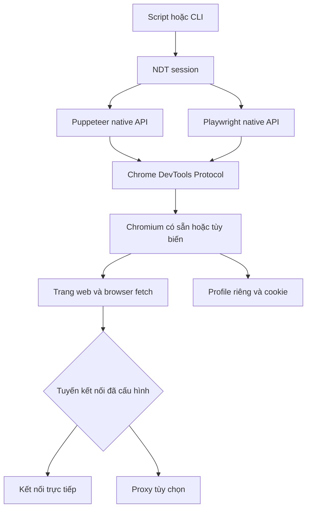

<div align="center">

# ◈ NDT Browser

**Browser thật. API automation gốc. Một bộ công cụ nhỏ gọn.**

Puppeteer · Playwright · API trong phiên browser · Scraping

[](https://github.com/nguyenduytan/ndt-browser/actions/workflows/ci.yml)
[](https://github.com/nguyenduytan/ndt-browser/releases)
[](https://nodejs.org/)
[](LICENSE)

[English](README.md) · **Tiếng Việt**

[Bắt đầu](#-bắt-đầu) · [Automation](#automation) · [Gọi API](#gọi-api) · [Challenge](#xử-lý-challenge) · [Docker](#docker)

</div>

---

NDT khởi chạy Chrome/Chromium thành tiến trình riêng, sau đó kết nối bằng Puppeteer
hoặc Playwright qua CDP. Bạn nhận `browser`, `context`, `page` native và các helper
nhỏ cho profile, request trong browser, extraction và chờ challenge.

**v0.1 là bộ công cụ automation có khả năng tinh chỉnh một số dấu hiệu detection.**
Đây không phải bản Chromium được patch toàn diện, dịch vụ giải CAPTCHA hay cam kết
vượt mọi Cloudflare. Phần [fingerprint](#fingerprint-và-runtime) ghi rõ phạm vi thực tế.

## Tính năng

| Khả năng | Puppeteer | Playwright |
|---|:---:|:---:|
| Launch Chromium local / kết nối CDP remote | ✓ | ✓ |
| Click, nhập liệu, keyboard, mouse, iframe, evaluate native | ✓ | ✓ |
| Theo dõi network, screenshot, download native | ✓ | ✓ |
| Profile lâu dài và tái sử dụng cookie | ✓ | ✓ |
| GET/POST và JSON trong phiên browser | ✓ | ✓ |
| Extraction CSS/text/attribute | ✓ | ✓ |
| Viewport, locale, timezone, UA và UA metadata | ✓ | ✓ |
| Proxy HTTP có xác thực | ✓ | ✓ |
| Chặn ảnh/font/media/stylesheet tùy chọn | ✓ | ✓ |
| Chờ challenge và click widget có giới hạn | ✓ | ✓ |

API gốc vẫn khác nhau giữa hai driver. Playwright kết nối Chromium qua CDP, không
phải giao thức Playwright; một số khả năng có độ tương thích thấp hơn cách launch
native của Playwright. Bản này không hỗ trợ Firefox/WebKit.

## Kiến trúc



Không cần database, tài khoản cloud hoặc CAPTCHA provider. Hai driver được cài cùng
package; browser binary được cài riêng, NDT không tự tải ngầm.

## 🚀 Bắt đầu

Cần Node.js **22.12+** và Chrome, Chromium hoặc Edge. Linux chạy có giao diện cần
display; server không có display có thể dùng `headless: true`.

Cài trực tiếp archive của GitHub Release, không phụ thuộc npm registry:

```bash
npm install https://github.com/nguyenduytan/ndt-browser/releases/download/v0.1.0/nguyenduytan-ndt-browser-0.1.0.tgz
```

Tạo `scrape.mjs`:

```js
import { connect } from '@nguyenduytan/ndt-browser';

const session = await connect({ driver: 'puppeteer', headless: true });
try {
  await session.page.goto('https://example.com', { waitUntil: 'domcontentloaded' });
  console.log(await session.extract({ title: 'h1' }));
} finally {
  await session.close();
}
```

```bash
node scrape.mjs
```

NDT tìm Chrome/Edge ở các đường dẫn cài thông dụng. Chọn binary cụ thể bằng:

```js
const session = await connect({
  driver: 'playwright',
  executablePath: 'C:/path/to/chrome.exe', // Linux: /path/to/chromium
  headless: true,
});
```

Hoặc đặt biến `NDT_BROWSER_PATH`. Đường dẫn chỉ định sai sẽ báo lỗi, không âm thầm
chuyển sang browser khác. Mặc định `headless: false`.

## Automation

### Puppeteer

```js
const session = await connect({ driver: 'puppeteer' });
try {
  const { page } = session;
  await page.goto('https://your-app.example/form');
  await page.type('#name', 'Tony');
  await page.click('button[type="submit"]');
  await page.waitForSelector('.success');
  await page.screenshot({ path: 'result.png', fullPage: true });
} finally { await session.close(); }
```

### Playwright

```js
const session = await connect({ driver: 'playwright' });
try {
  const { page } = session;
  await page.goto('https://your-app.example/form');
  await page.getByLabel('Name').fill('Tony');
  await page.getByRole('button', { name: 'Save' }).click();
  await page.locator('.success').waitFor();
  console.log(await page.locator('.success').innerText());
} finally { await session.close(); }
```

Upload, download, screenshot, iframe, keyboard/mouse và network interception dùng
API gốc. Với click gây navigation, đăng ký chờ trước khi click theo hướng dẫn của
driver. NDT **không tự retry click hoặc POST**, tránh thực hiện tác vụ hai lần.

### Nhiều page và hook native

```js
const page = await session.newPage();
await page.goto('https://example.com');
console.log(await session.extract({ title: 'h1' }, page));
```

`session.newPage()` áp dụng cấu hình NDT trước khi trả page. Nếu dùng trực tiếp
`session.context.newPage()`, gọi `await session.configurePage(page)` trước navigation.
Popup, worker và page tạo bằng native API không tự được patch. Không kết hợp native
interception với resource blocking/proxy auth của NDT nếu chưa test tương tác giữa chúng.

## Gọi API

`session.request()` chạy `fetch` **bên trong page**, dùng cookie, network stack và proxy
của browser. Không fallback sang Node HTTP trực tiếp. Hãy mở origin của API trước.

```js
await session.page.goto('https://your-app.example');
const response = await session.request('https://your-app.example/api/items', {
  method: 'POST',
  json: { name: 'NDT', enabled: true },
  headers: { 'x-csrf-token': csrfToken }, // Lấy từ ứng dụng của bạn.
  timeout: 15_000,
  maxBytes: 2 * 1024 * 1024,
});
if (!response.ok) throw new Error(`API returned HTTP ${response.status}`);
console.log(response.json());
```

| Tùy chọn | Mặc định | Ý nghĩa |
|---|---|---|
| `method` | `GET` | HTTP method |
| `headers` | Không | Header được browser fetch cho phép |
| `json` | Không | Body JSON; tự thêm content-type nếu chưa có |
| `body` | Không | Body chuỗi; không dùng đồng thời với `json` |
| `credentials` | `same-origin` | Chính sách credentials của fetch |
| `timeout` | Timeout session | Hủy fetch/đọc response sau số ms này |
| `maxBytes` | 10 MiB | Giới hạn byte response đã giải mã |

Kết quả: `{ url, status, ok, headers, body, json() }`. `body` là UTF-8 text; `json()`
parse JSON và báo lỗi nếu không hợp lệ. HTTP 4xx/5xx vẫn trả response; lỗi mạng,
timeout hoặc vượt byte limit sẽ reject. GET/HEAD không được có body.

Gửi form bằng `body: new URLSearchParams(fields).toString()` và content type phù hợp.
Với binary streaming hoặc multipart phức tạp, dùng native API.

**CORS, CSRF và quy tắc forbidden header vẫn áp dụng.** API khác origin cần server
cho phép CORS. Nếu API trả trang challenge, hãy xử lý luồng navigation trước.
Không tự gửi lại POST sau timeout vì server có thể đã xử lý thành công. Native
`context.request` của Playwright là transport khác, không thuộc bảo đảm routing
browser của helper NDT.

## Extraction

```js
const data = await session.extract({
  title: 'h1',
  price: { selector: '[data-price]', attribute: 'data-price', required: true },
  links: { selector: 'a', attribute: 'href', multiple: true },
});
```

- Text dùng `textContent.trim()`, không lọc theo độ hiển thị.
- Field/attribute đơn không có: `null`. Danh sách không có: `[]`.
- `required: true` báo lỗi khi thiếu element/attribute; text rỗng vẫn là `''`.
- Attribute giữ nguyên giá trị; đổi URL tương đối bằng `new URL(value, page.url())`.
- CSS sai sẽ báo lỗi. Helper đọc DOM của main document; iframe/shadow DOM dùng native API.

## Xử lý challenge

```js
import { connect, ChallengeTimeoutError } from '@nguyenduytan/ndt-browser';

const session = await connect({ driver: 'playwright', userDataDir: './profiles/site' });
try {
  await session.page.goto('https://your-app.example');
  const result = await session.waitForChallenge({
    readySelector: '#app',
    timeout: 45_000,
    clickTurnstile: true,
    maxClicks: 3,
  });
  console.log(result); // { status: 'ready', detected, clicks, elapsedMs }
} catch (error) {
  if (error instanceof ChallengeTimeoutError) console.error('Cần thao tác thủ công hoặc runtime khác.');
  else throw error;
} finally { await session.close(); }
```

NDT nhận diện một số marker interstitial, header main-document `cf-mitigated: challenge`,
widget Turnstile và response field chuẩn. Sau khi challenge hết hoặc có response,
helper đợi trạng thái sẵn sàng ổn định. Hỗ trợ redirect thay execution context và hủy
bằng `AbortSignal`. Mặc định poll 250 ms, ổn định 500 ms, timeout 30 giây.

Click là tùy chọn, tắt mặc định, chỉ dùng native mouse với widget nhận diện được,
có cooldown và giới hạn số lần. **Đây là heuristic, không phải solver.** Closed shadow
DOM, layout tùy biến, response field đổi tên hoặc thay đổi từ nhà cung cấp có thể cần
native automation hoặc thao tác thủ công. Có token chưa chứng minh server đã chấp nhận;
`readySelector` nên trỏ vào nội dung thật mà tác vụ cần.

Fixture local kiểm tra chờ, click, hủy và giới hạn lỗi; không chứng minh qua Cloudflare
thật. Không có CAPTCHA provider hoặc token giả. Chỉ automation trong phạm vi được phép.

## Fingerprint và runtime

```js
const session = await connect({
  driver: 'puppeteer',
  headless: false,
  userDataDir: './profiles/my-site',
  reduceAutomationSignals: true,
  fingerprint: {
    locale: 'vi-VN',
    timezone: 'Asia/Ho_Chi_Minh',
    viewport: { width: 1365, height: 768, deviceScaleFactor: 1 },
  },
  args: [],
});
```

NDT không dùng toàn bộ launch flags mặc định của driver. Mặc định thêm
`--disable-blink-features=AutomationControlled`; tắt bằng `reduceAutomationSignals: false`.
Không tắt Chromium sandbox mặc định. Locale/timezone/viewport và UA metadata tùy chọn
được đặt bằng CDP native.

Không có patch canvas, WebGL, audio, fonts, TLS hoặc Chromium internals. Worker/popup
có thể mang cấu hình khác. UA tự đặt có thể mâu thuẫn với phần cứng/client hints;
không nên tạo fingerprint ngẫu nhiên không nhất quán.

Dùng `executablePath`/`args` cho Chromium tùy biến tương thích hoặc kết nối runtime
được launch bên ngoài. NDT không tự tải, cấp license, cập nhật hay chứng nhận binary
CloakBrowser/nhà cung cấp khác. Điều khoản và compatibility của chúng áp dụng riêng.

## Profile, remote browser và cleanup

```js
const local = await connect({ userDataDir: './profiles/catalog', headless: true });
await local.close(); // Giữ profile, cookie, storage và cache.

const remote = await connect({ driver: 'playwright', endpoint: process.env.CDP_URL });
try { await remote.page.goto('https://example.com'); }
finally { await remote.close(); }
```

Profile tạm được xóa khi browser do NDT sở hữu đã thoát; profile persistent được giữ.
Luôn dùng thư mục riêng, không dùng profile browser hằng ngày. Mỗi profile chỉ có một
session NDT hoạt động. Cookie/cache là dữ liệu nhạy cảm: đặt quyền OS phù hợp và không commit.

`close()` gọi nhiều lần được. Remote close chỉ đóng context NDT tạo và ngắt kết nối,
không đóng tab có sẵn. Dùng `try/finally`; kill tiến trình đột ngột có thể để lại browser
và `.ndt-lock`. Chỉ dọn lock/`DevToolsActivePort` cũ sau khi chắc chắn không có browser
đang sở hữu profile. NDT không tự đoán để chiếm profile sau crash.

Remote mode không nhận profile, proxy, executable, headless hoặc args local; cấu hình
chúng ở runtime remote. `session.endpoint` là địa chỉ CDP có quyền điều khiển browser,
không công khai. Gọi **`session.close()`** thay vì `browser.close()` native nếu mượn browser.

## Proxy và tiết kiệm lưu lượng

```js
const session = await connect({
  headless: true,
  userDataDir: './profiles/catalog',
  proxy: { server: process.env.PROXY_SERVER, username: process.env.PROXY_USER, password: process.env.PROXY_PASSWORD },
  blockResources: ['image', 'font', 'media'],
});
// ... automation ...
console.log(session.stats); // requests, blocked, transferredBytes
```

Cho phép endpoint HTTP(S), SOCKS5 không xác thực. Integration test local kiểm tra
**HTTP proxy có xác thực** trên hai driver. SOCKS5 username/password bị từ chối.
Credentials chỉ gửi cho proxy auth challenge, không gửi cho origin auth challenge.
Browser vẫn có proxy bypass rules thông thường, gồm địa chỉ local; đây không phải
ranh giới ngăn mọi rò rỉ network.

Tái sử dụng session/cache, gọi đúng API cần lấy và chặn tài nguyên nặng không cần thiết.
Đừng chặn script challenge hoặc tài nguyên cần cho ứng dụng hoạt động.
`transferredBytes` là byte transfer CDP trên page được cấu hình, không phải hóa đơn
proxy và không bao gồm toàn bộ background traffic của browser.

## Cấu hình

| Tùy chọn connect | Mặc định | Ý nghĩa |
|---|---|---|
| `driver` | `puppeteer` | `puppeteer` hoặc `playwright` |
| `executablePath` | Env / tự tìm | Binary Chromium local |
| `endpoint` | Không | CDP endpoint HTTP(S)/WS(S) |
| `headless` | `false` | Chế độ giao diện local |
| `userDataDir` | Thư mục tạm | Profile riêng persistent |
| `timeout` | `30000` | Startup/native waits/request mặc định, ms |
| `reduceAutomationSignals` | `true` | Launch flag AutomationControlled |
| `fingerprint` | Runtime native | Locale/timezone/viewport/UA/metadata |
| `headers` | Không | Extra headers trên page |
| `proxy` | Không | Proxy của browser local |
| `blockResources` | `[]` | `image`, `media`, `font`, `stylesheet` |
| `args` | `[]` | Flags Chromium bổ sung |

Không tự xoay proxy hoặc retry request. Không đặt secret trong `args`; flags có thể
xuất hiện trong process listing. Extra headers trên page có thể gửi sang origin của
subresource, nên không dùng chúng để phát tán secret dùng chung.

## CLI

```bash
npx ndt-browser scrape https://example.com --headless --selector h1
npx ndt-browser scrape https://example.com --driver playwright --headless --schema schema.json
npx ndt-browser scrape https://example.com --endpoint http://127.0.0.1:9222
npx ndt-browser --help
```

Sau khi cài release, `npx` dùng executable local. CLI xuất một JSON ra stdout, lỗi ra
stderr, exit 0 khi thành công và 1 khi lỗi. Khi bị ngắt sẽ cố cleanup. Dùng SDK cho POST,
automation phức tạp hoặc challenge. CLI thành công không đồng nghĩa HTTP 2xx; kiểm tra `status`.

## Docker

Docker chạy Linux Chromium và NDT trong container; máy host không cần cài Chrome.
Xem [hướng dẫn Docker](docs/docker.md) để build, chạy CLI, chạy script riêng, persistent
profile, headed/Xvfb, Compose và giới hạn tài nguyên. Container không tự làm browser
ít bị phát hiện hơn; runtime, môi trường và website vẫn ảnh hưởng kết quả.

## Phát triển và kiểm thử

```bash
git clone https://github.com/nguyenduytan/ndt-browser.git
cd ndt-browser
npm ci
npm test
npm run typecheck
npm pack
```

Test dùng HTTP/proxy/widget fixture local và Chromium thật. Bao phủ cả hai driver,
click/fill, extraction, authenticated POST, resource blocking, profile reuse, remote
ownership, cleanup khi setup lỗi, challenge và CLI. CI chạy Windows/Linux/macOS và
Docker; không cần gọi website production hoặc provider trả phí.

## Xử lý lỗi thường gặp

| Hiện tượng | Cách kiểm tra |
|---|---|
| Không tìm thấy browser | Đặt `executablePath` hoặc `NDT_BROWSER_PATH` |
| Browser thoát ngay | Kiểm tra binary, thư viện OS, display và quyền sở hữu profile |
| Profile bị lock | Đóng owner trước, rồi mới kiểm tra lock cũ |
| API fetch thất bại | Kiểm tra origin, CORS, CSRF và authentication |
| Challenge timeout | Kiểm tra ready selector, dùng headed/manual hoặc runtime tương thích khác |
| Trang lỗi sau resource blocking | Bỏ các resource type bị chặn và test lại |
| Update runtime làm lỗi CDP | Pin browser/driver tương thích và test trước khi nâng cấp |

## Tham khảo và phạm vi

Tham khảo kiến trúc [Puppeteer Real Browser](https://github.com/ZFC-Digital/puppeteer-real-browser),
[Scrapling](https://github.com/D4Vinci/Scrapling) và
[CloakBrowser](https://github.com/CloakHQ/CloakBrowser). Code NDT viết riêng, không đóng
gói source hoặc binary của các dự án đó. Dependency là Playwright Core và Puppeteer
Core. Code NDT dùng MIT; browser binary giữ license riêng.

NDT là SDK local cho người gọi tin cậy, **không phải public scraping endpoint có sandbox**.
Xem [SECURITY.md](SECURITY.md) và [release notes](CHANGELOG.md).
